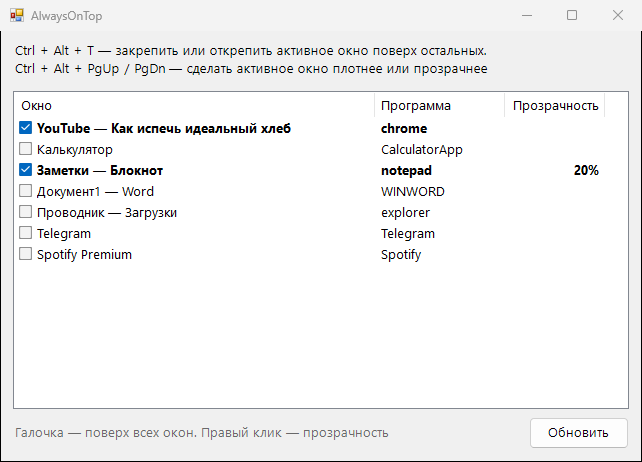

<div align="center">

# 📌 AlwaysOnTop

**Закрепляет любое окно поверх остальных одной горячей клавишей и умеет делать окна полупрозрачными**




</div>

## ✨ Возможности

- ⌨️ `Ctrl+Alt+T` закрепляет активное окно поверх всех, повторное нажатие открепляет
- 🌫️ `Ctrl+Alt+PgUp` / `PgDn` делает окно прозрачнее или плотнее с шагом 10%
- ☑️ Список открытых окон: поставь галочку, и окно будет поверх остальных. Правый клик задаёт прозрачность
- 🔁 При выходе из программы все закреплённые ей окна открепляются обратно
- 📥 Живёт в трее, почти не занимает памяти

## 💡 Когда пригодится

- Видео или стрим в углу экрана, пока работаешь
- Калькулятор, заметки или переводчик поверх документа
- Сверяешься с инструкцией, не переключаясь между окнами
- Полупрозрачный чат поверх игры в оконном режиме

## 📥 Установка

1. Скачай `AlwaysOnTop.exe` из раздела [**Releases**](../../releases/latest)
2. Запусти его, установка не нужна

## 🛠️ Сборка из исходников

Нужен только Windows: компилятор C# входит в состав .NET Framework.

```bat
build.bat
```

## 📄 Лицензия

[MIT](LICENSE)
